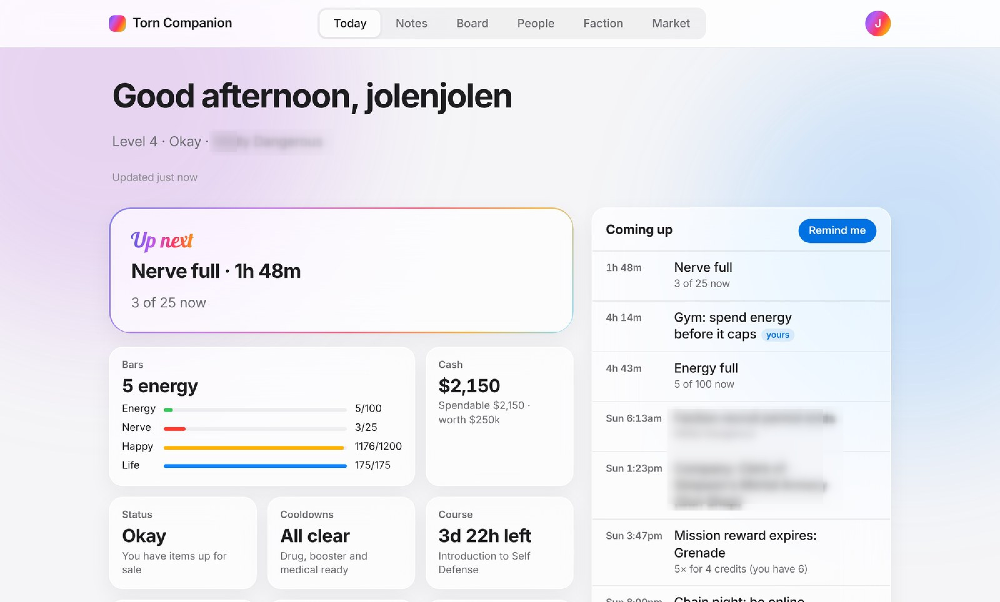
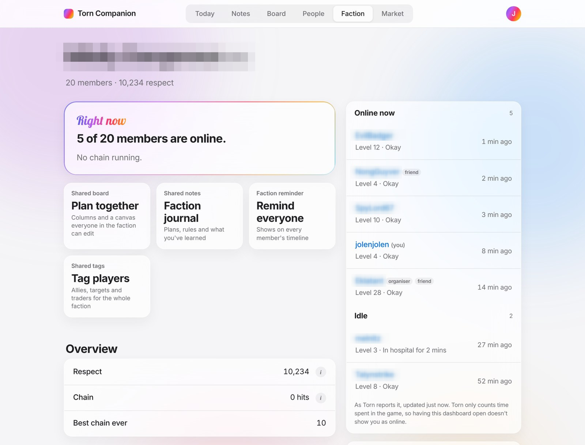
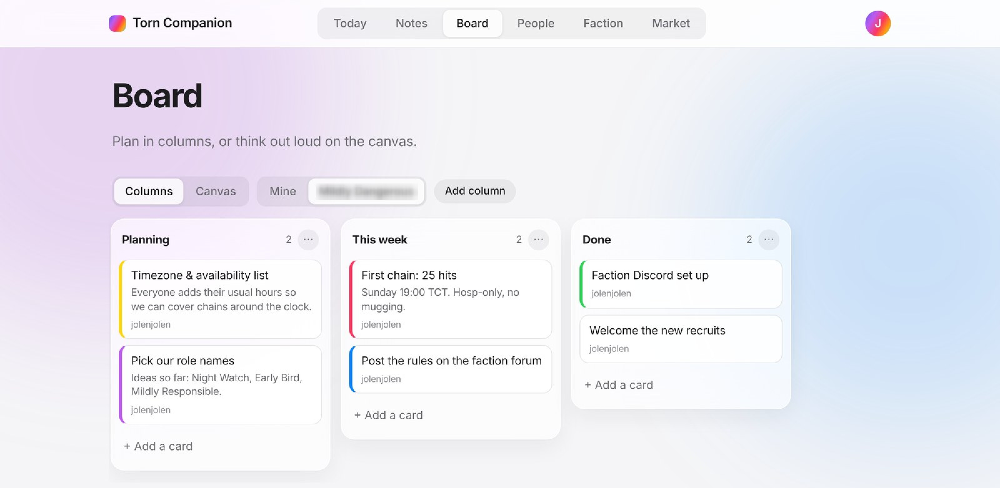
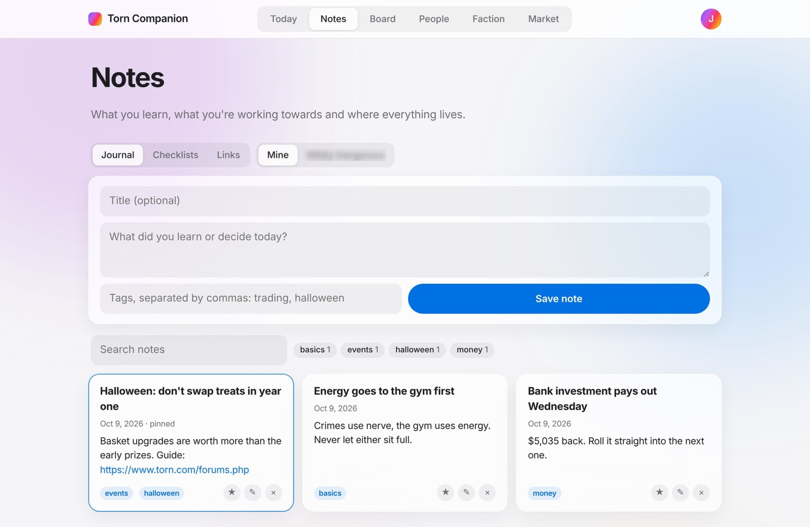
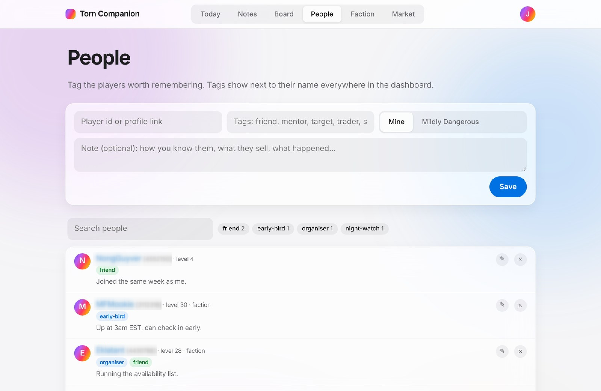
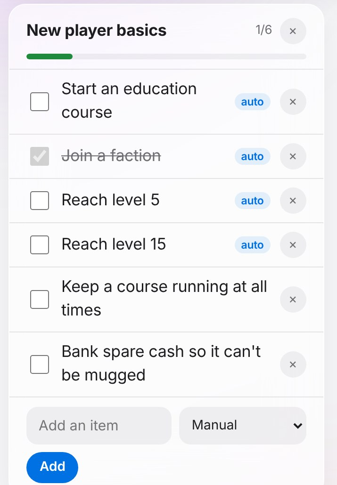
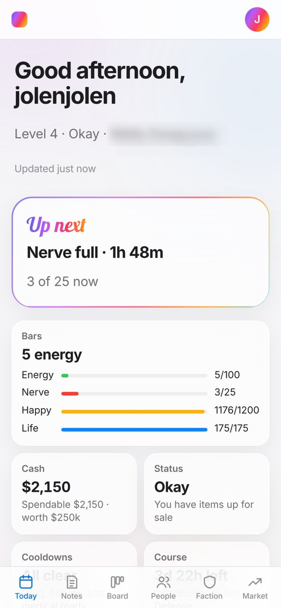
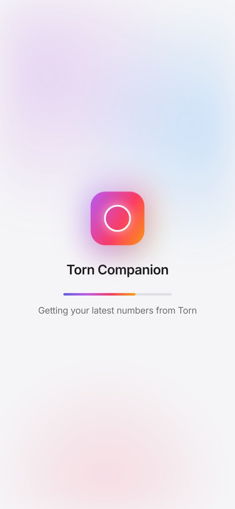

<p align="center">
  
</p>

<h1 align="center">Torn Companion</h1>

<p align="center">
  <b>The planner, notebook and faction hub for <a href="https://www.torn.com">Torn City</a>.</b><br>
  Every timer the API knows about, in one timeline you never have to type.
</p>

<p align="center">
  
  
  
  
  
</p>

<p align="center">
  
</p>

## What it does

Sign in with a **Limited Access** Torn API key and you get:

| Feature | What you get |
|---|---|
| **🗓️ Today** | Tiles for everything the API can show: bars, cash, status, cooldowns, course, home, faction, job, fights, events, points, missions. Tap any tile for the detail. |
| **⏱️ A timeline that builds itself** | Rent due, course finishing, drug/booster/medical cooldowns, bank investment maturing, travel landing, mission rewards expiring, unused refills, organised crimes and Torn calendar events, plus your own reminders, one-off or repeating. |
| **🔔 Notifications** | Optional browser and phone notifications for anything on the timeline, chosen per kind. |
| **📓 Notes** | A journal for what you learn (tags, pins, search), checklists whose items can tick themselves from the API, and a links shelf for Discord servers, guides and forum threads. |
| **🧩 Board** | Columns for planning, plus a freeform canvas with sticky notes and arrows. |
| **🏷️ People** | Tag players (friend, trader, target, scammer…) with a note. Tags show next to their name everywhere. |
| **🛡️ Faction** | Every note, checklist, reminder, tag, link and board can be private or shared with your faction. See who's online, idle, in hospital or travelling. |
| **📈 Market** | Shared price history for every item, a watchlist, and an optional Gemini advisor that shows the numbers behind each suggestion. |

It only ever **reads** the Torn API. It never takes actions in the game.

## Screenshots

<table>
  <tr>
    <td width="50%"><br><sub><b>Faction</b>: who's around, shared tools and links</sub></td>
    <td width="50%"><br><sub><b>Shared board</b>: plan chains and wars together</sub></td>
  </tr>
  <tr>
    <td width="50%"><br><sub><b>Journal</b>: tags, pins and search</sub></td>
    <td width="50%"><br><sub><b>People</b>: private or faction-wide player tags</sub></td>
  </tr>
</table>

<table>
  <tr>
    <td width="33%" align="center"><br><sub>"auto" items tick themselves</sub></td>
    <td width="33%" align="center"><br><sub>Built for phones too</sub></td>
    <td width="33%" align="center"><br><sub>Add it to your Home Screen</sub></td>
  </tr>
</table>

<sub>Screenshots use a real account with cash and battle stats replaced by demo values.</sub>

## Data and your key

As Torn's API rules require, the sign-in screen and Settings show this table too.

| | Details |
|---|---|
| **Data storage** | Your Torn data (bars, money, items, events, fights, faction) while you use the site, plus anything you write: notes, checklists, reminders, tags and links. Market prices are shared and contain no personal data. |
| **Data sharing** | Nobody else sees your personal data. Things you share with your faction are visible to its members. The public sees anonymous usage counts; the server owner can see who has signed up (name, level and last visit). |
| **Purpose of use** | Showing you your own timers, stats and plans, and running your faction's shared space. |
| **Key storage & sharing** | Encrypted at rest and never shown to anyone. Used only while you have the site open, or every 10 minutes in the background if you turn notifications on. Deleting your account in Settings removes it. |
| **Key access level** | Limited Access. Read-only. |

## How it works

- **Shared market history.** The server logs every item's market value hourly, sweeps real item-market listings in a slow rotation, and records circulation daily. This is collected once, with the server's own key, and every player sees it, so new players get the full history from day one.
- **Personal data per player.** Each player's bars, inventory, fights, watchlist and advice are fetched with *their* key, only while they have the dashboard open, and are only ever shown to them.
- **Keys are encrypted at rest** (Fernet, with a server secret). Sessions are random tokens in an HttpOnly cookie; only a hash is stored.
- **Sign-in is checked against Torn**, and the key must have Limited Access. Failed attempts are rate-limited per IP, because Torn temporarily bans IPs that send many invalid keys.
- **Notifications are opt-in.** Only while a player has notifications turned on does the server use their key in the background, at most every `NOTIFY_REFRESH` seconds (10 minutes), to keep their timeline current.
- **Private and faction spaces.** Faction access is checked against the player's own Torn profile each time, so leaving a faction removes access to its shared space.
- **The advisor is opt-in per player.** Each player can add their own Gemini key in Settings. Nobody else's advice is paid for by the server owner unless the owner lists them in `SHARE_GEMINI_WITH`.

As Torn's API rules require, the sign-in screen and Settings show exactly what is stored, who can see it, what it's for, how the key is kept and which access level is needed.

## Layout

```
torn-dash/
  app/
    main.py        FastAPI routes, sign-in, settings
    auth.py        session cookie and current player
    planner.py     notes, checklists, reminders, people, links, board, canvas
    timers.py      builds the timeline from the API (rent, cooldowns, icons…)
    push.py        browser notifications (Web Push, VAPID)
    users.py       players, encrypted keys, sessions, sign-in limits
    players.py     per-player data, fetched on demand with each player's key
    collectors.py  shared market logging with the server key
    analytics.py   to-dos, faction summary, candidates, deals, price history
    ai.py          Gemini advisor (per-player keys, daily limit)
    torn.py        Torn API client + rate limiter
    db.py          SQLite storage and upgrades
    config.py      settings from .env
    knowledge.md   facts the advisor may use (edit freely)
    static/        index.html, app.css, core.js, today.js, notes.js,
                   board.js, people.js, market.js, app.js, sw.js, manifest
  scripts/export_market.py   share your market history (no personal data)
  seed/                      put someone's market.db here to start with their history
  requirements.txt
  .env.example
  torn-dash.service
```

## Run it

```bash
git clone https://github.com/GITHUB_USER/torn-dash.git && cd torn-dash
python3 -m venv .venv
.venv/bin/pip install -r requirements.txt
cp .env.example .env && nano .env      # at least TORN_KEY
.venv/bin/uvicorn app.main:app --host 0.0.0.0 --port 8080 --proxy-headers
```

Open `http://<pi-ip>:8080` and sign in. **The first player to sign in becomes the owner.**

As a service (edit `User` and paths in the file first):

```bash
sudo cp torn-dash.service /etc/systemd/system/
sudo systemctl daemon-reload && sudo systemctl enable --now torn-dash
journalctl -u torn-dash -f
```

### Opening it to other players

Players paste their API key into this site, so **only expose it over HTTPS**. A Cloudflare Tunnel or a reverse proxy (Caddy, nginx) in front of port 8080 works well. Cookies switch to secure mode automatically when the request arrives over HTTPS.

**Notifications need HTTPS** (browsers only allow them on secure sites, or on `localhost`). On iPhone and iPad, open the site in Safari, tap Share → Add to Home Screen, then turn notifications on from the Home Screen app. Set `VAPID_SUBJECT` in `.env` to a contact address for push services.

Control who can sign in with `ALLOW_SIGNUPS`, `ALLOWED_PLAYERS` and `MAX_USERS` in `.env`.

## Sharing your market history

Price history is the slow part to build. To give it to people running their own copy:

```bash
.venv/bin/python scripts/export_market.py      # writes seed/market.db
```

The file contains only items, prices, listings and circulation. It has no players, keys or personal data. Anyone who puts it at `seed/market.db` before their first start begins with that history.

## Request budget

Torn allows 100 requests a minute per player across all their tools.

- **Server key:** item values hourly (1 call), the listing sweep (`MARKET_SWEEP_RPM`, default 4/min), every watched item every 10 minutes, and the full catalogue and event calendar once a day.
- **Each player's key, only while they have the dashboard open:** personal data every minute (6 calls), events and fights every 5 minutes, timers every `TIMERS_EVERY` seconds (5 minutes, about 5 calls), faction every 2 minutes, and inventory hourly (one call per item category, about 30).

**With notifications on**, the same refresh also runs in the background at most every `NOTIFY_REFRESH` seconds (10 minutes), even with the dashboard closed.

Detail older than `PRUNE_AFTER_DAYS` (90) is thinned to one point per item per day.

## Advisor

Each player adds a Gemini key in Settings. Gemini API keys are prepay: add credit in Google AI Studio under Billing. `AI_DAILY_LIMIT` caps calls per player per day. The owner can instead set `GEMINI_API_KEY` (or `GOOGLE_CLOUD_PROJECT` for Vertex AI) in `.env` for themselves, and share it with specific players via `SHARE_GEMINI_WITH`.

The advisor gets the player's cash, inventory, recorded price history, candidates, watchlist and upcoming events, plus everything in `app/knowledge.md`. It's told to use only that data and to cite the numbers behind each suggestion. It never sees anyone's Torn key.

## Upgrading from the single-user version

Start the new version with your existing `torn.db`. Personal tables are upgraded in place and your data is assigned to your player id; sign in with your key to see it. Your `.env` keeps working, and `TORN_KEY` becomes the server key for market logging.

## Upgrading from the market-only version

```bash
.venv/bin/pip install -r requirements.txt   # adds pywebpush for notifications
sudo systemctl restart torn-dash
```

New tables are created on start; existing data is untouched. A VAPID key for notifications is generated in `data/vapid_private.pem`; keep it, or everyone has to turn notifications on again.
